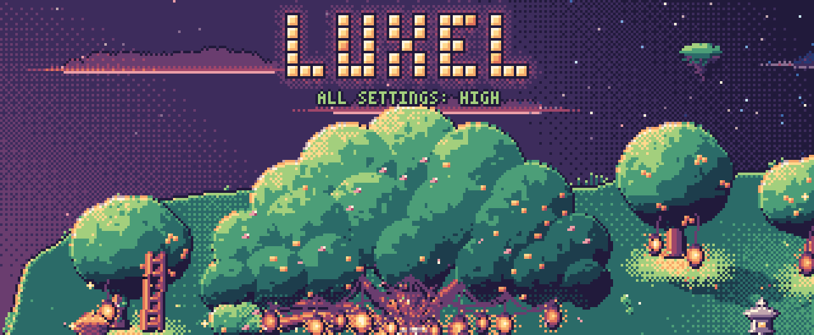
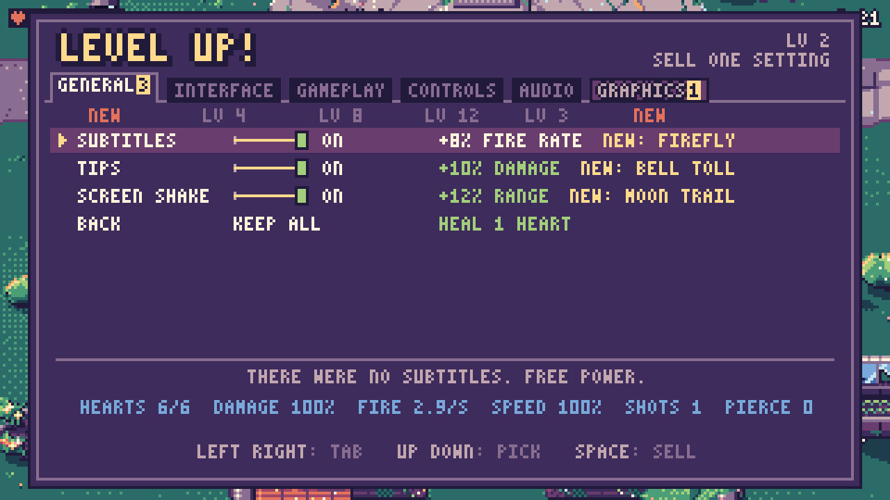
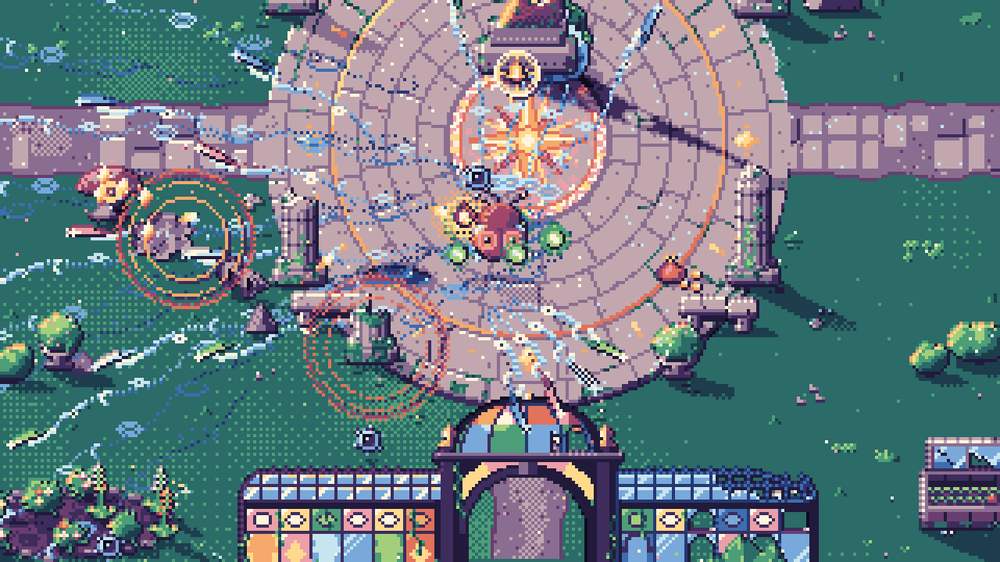
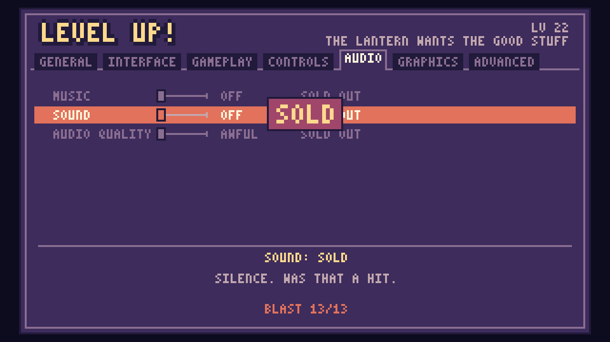
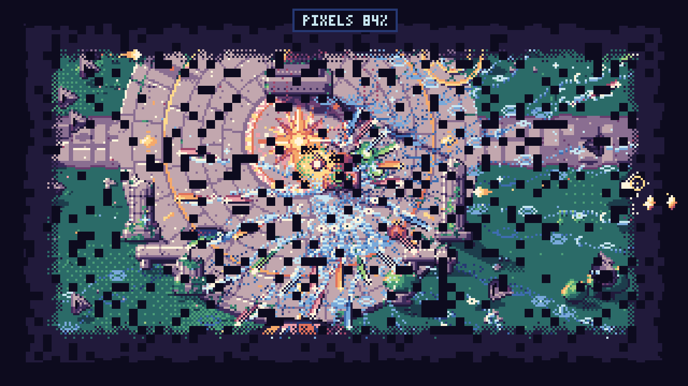

<p align="center">
  
</p>

<h1 align="center">Luxel</h1>

<p align="center">
  <b>A survivor where the upgrade shop is the game's own Settings menu.<br>
  Sell your subtitles, your HUD, your controls and finally your pixels for power.</b>
</p>

<p align="center">
  <a href="https://marwanmoh11.github.io/luxel/play/"><b>Play in your browser</b></a>
  &nbsp;·&nbsp;
  <a href="https://marwanmoh11.github.io/luxel/">Website</a>
  &nbsp;·&nbsp;
  <a href="https://github.com/MarwanMoh11/luxel/releases/latest">Downloads</a>
</p>

<p align="center">
  Godot 4.7 &nbsp;·&nbsp; GDScript &nbsp;·&nbsp; game jam entry, theme <b>Trade-off</b> &nbsp;·&nbsp; one run is about 7 minutes
</p>

---

## The game

The dark comes every night to eat the light. Wick, a lamplighter moth, carries the last lantern on the
island. The lantern fires by itself. You only move.

Killed enemies drop light shards that fill the lantern. Each time it fills, the game's **Settings**
menu opens, and you sell one setting for a power. Subtitles go for fire rate. The heart display goes
for two more hearts you can no longer see. Your own Up key goes for damage, and from then on it
cuts out now and then.

The trade-off is the whole game: every setting you sell makes the game a little worse and you a
little stronger.

<table>
  <tr>
    <td></td>
    <td></td>
  </tr>
  <tr>
    <td align="center">Every level-up opens Settings. Sell a row, get the power next to it.</td>
    <td align="center">The lantern grows new forms as you sell: fireflies, bell tolls, needles, moon trails.</td>
  </tr>
</table>

## How to play

| Input | Does |
|---|---|
| Arrows or WASD | Move Wick. The only input in play: the lantern aims and fires by itself. |
| Space or Enter | Start, sell the picked row, confirm |
| Left / Right (A / D) | Menu: change tab |
| Up / Down (W / S) | Menu: pick a row |
| Esc or P | Pause. On the pause card: Space resumes, R restarts, Q goes to the title. |
| Hold R (half a second) | Restart the run |
| F11 or Alt+Enter | Fullscreen |

The first play has a 24-second story intro (any key skips it) and a short tutorial in the first half
minute. A death costs you the run, and Space starts a new one at once.

## What makes it tick

- **The shop is the Settings menu.** Tabs, sliders and toggles, the way a real options screen looks.
  Each row shows what it pays and which lantern form it lights (`NEW: FIREFLY`).
- **Comfort first, beauty last.** Early on you sell comfort: tips, the HUD, difficulty, mercy time,
  your controls. The graphics and audio rows are stamped `NOT FOR SALE` until the finale, so the island
  and the music stay beautiful for most of the run.
- **Buy back, once.** From 11 settings sold, a menu can return one sold setting instead. The power
  stays.
- **Six enemies, each with a tell**: a pose, a sound or a shadow. Late in the run, the sales start
  taking those tells away.
- **Short, escalating runs.** About six and a half minutes to the end, then a one-minute ending.

<details>
<summary><b>The finale (spoilers)</b></summary>
<br>

<table>
  <tr>
    <td></td>
    <td></td>
  </tr>
</table>

The dark swells and there are too many of them. You sell one last setting, CONFIRM SALES, and the
menu starts selling the game's looks by itself: the music, the colours, the resolution, the sound.
Each of the 13 or more sales (one blast per setting still standing) charges the lantern for one big blast. The blast clears the horde and leaves the
screen broken, and you relight it by hand. Then the rest of the dark arrives, and the only setting left is PIXELS. You sell them one
percent at a time until DISPLAY: OFF.

</details>

## Build and run from source

You need [Godot 4.7.2](https://godotengine.org/download/archive/4.7.2-stable/) (standard build, not .NET).
The project uses the GL Compatibility renderer so the web export works.

```sh
git clone https://github.com/MarwanMoh11/luxel.git
cd luxel
GODOT=/Applications/Godot.app/Contents/MacOS/Godot   # or the path to your Godot 4.7.2 binary

"$GODOT" --headless --path . --editor --quit   # first import (builds .godot/)
"$GODOT" --path .                              # play
```

Or open `project.godot` in the Godot editor and press Play. The main scene is `scenes/main.tscn`.

**Debug arguments** go after `--`, for example `"$GODOT" --path . -- run seed=2`:
`run` (skip the title), `tutorial`, `swell`, `closing`, `blast`, `relight`, `pixels`, `ending` (jump
there), `lab=<id>` (one enemy kind), `at=<seconds>` (enemy clock), `seed=<n>`. In debug runs, keys 1-6
and 0 drop enemies and F5 fills the gauge. Debug runs save to `user://low_settings_debug.cfg`, never
the player's save.

**Web export** needs the 4.7.2 export templates (Editor > Manage Export Templates):

```sh
"$GODOT" --headless --path . --export-release "Web" build/web/index.html
python3 -m http.server 8000 -d build/web    # then open http://localhost:8000
```

Threads are off, so the build needs no special server headers.

## Project layout

| Path | What is there |
|---|---|
| `scenes/main.tscn` | the whole game: title, intro, tutorial, run, finale, ending, results |
| `scripts/game/` | `main.gd` (the flow), `run/` (the simulation, player, combat, enemies, director), `shop/`, `fx/` (what each sold setting does to the game, music), `ui/`, `screens/`, `story/story_text.gd` (every line of text) |
| `scripts/cast/` | Wick, the lantern's light forms, shards, and the six enemy brains (`enemies/README.md` is their contract) |
| `scripts/conductor.gd`, `display.gd` | autoloads: the audio clock and the window or fullscreen handling |
| `art/`, `audio/` | sprites, the map, the music and sound effects |
| `web/` | the custom web page the browser build runs in |
| `website/` | the source of the game's website |

## How it was made

Luxel was made for a game jam on the theme **Trade-off**, in October 2026, in Godot 4.7 and GDScript.

| | |
|---|---|
| Marwan Abudaif | Concept, game design, technical architecture, story, art and audio direction, debugging, play-testing and tuning |
| [Claude Code](https://claude.com/claude-code) (AI) | Implementation, working to Marwan's designs |

## Credits and licence

All rights reserved, see [LICENSE](LICENSE); third-party credits in [CREDITS.md](CREDITS.md).
The sound effects come from Kenney's CC0 packs, the instruments from the MuseScore General soundfont
(MIT), and the engine is Godot (MIT).
